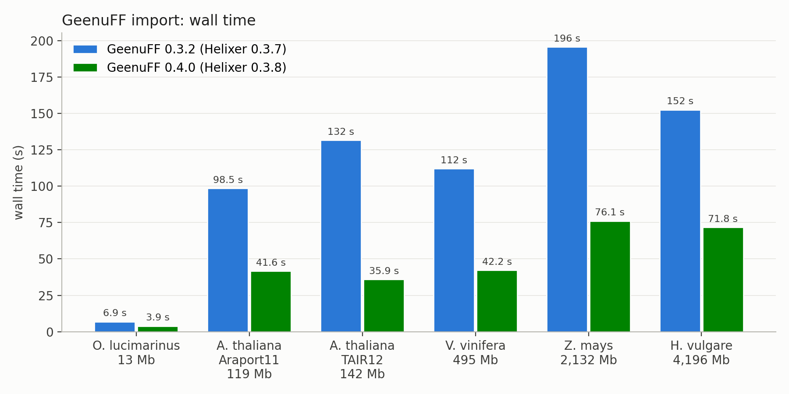
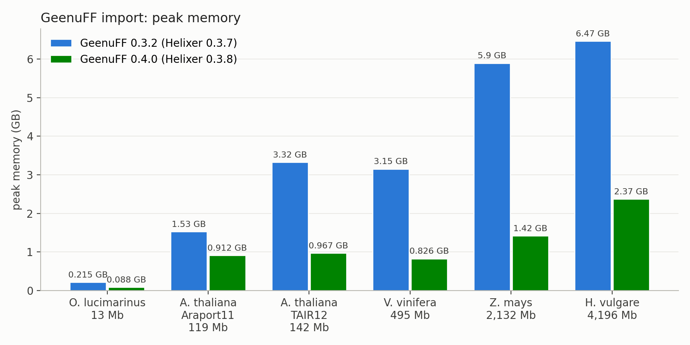
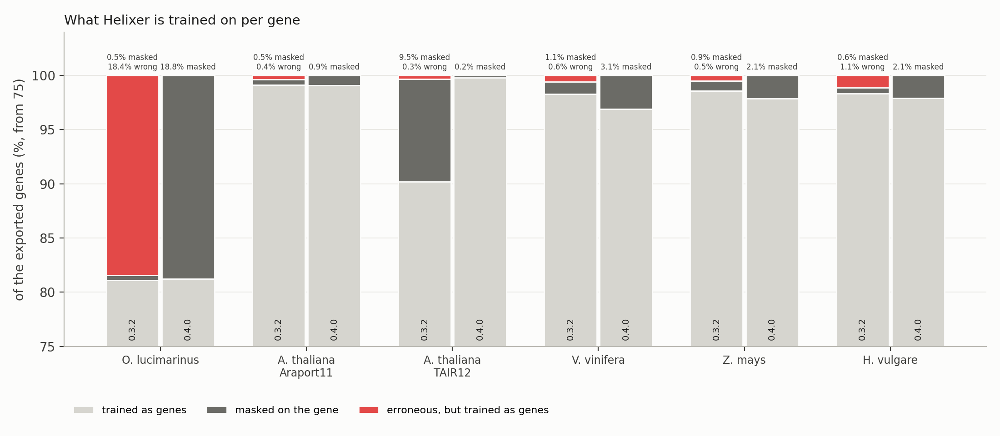
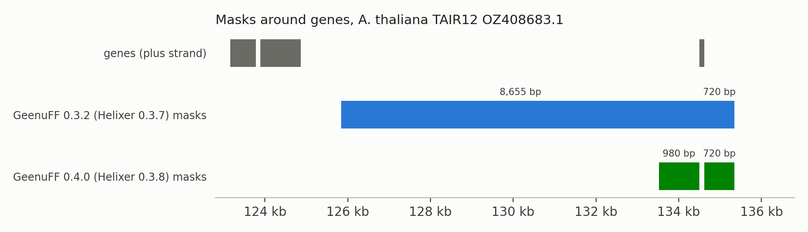

# Import speed, memory and masking: GeenuFF 0.4.0 against 0.3.2

GeenuFF 0.4.0 imports a genome 2.0 to 3.7 times faster than GeenuFF 0.3.2 and needs 1.2 to 2.7
times less memory. It masks genes with errors of their own on the gene, where 0.3.2 mostly masked
only beside them, and masks far fewer intergenic bases.

## Setup

|             |                                                                |
|-------------|----------------------------------------------------------------|
| CPU         | AMD EPYC 9124, 16 cores, 32 threads                            |
| memory      | 377 GB                                                         |
| storage     | NVMe SSD (Micron 7450)                                         |
| system      | Ubuntu 24.04.4 LTS, Linux 7.0.0                                |
| software    | Python 3.10.20, SQLite 3.45.1, SQLAlchemy 1.3.22, NumPy 1.26.4 |
| old version | GeenuFF 0.3.2, as installed with Helixer 0.3.7                 |
| new version | GeenuFF 0.4.0, as installed with Helixer 0.3.8                 |

Each genome was prepared once with the 0.4.0 preparation scripts (`rename_gff_seqids.py`,
`filter_sequence_lengths.py`, `add_gene_lines.py`, `add_transcript_lines.py`, `rebuild_exons.py`,
see [scripts.md](scripts.md)), and both versions imported the same decompressed files, one import
at a time, measured with `/usr/bin/time -v` (wall time and peak resident memory). The input was read
once beforehand, so both versions found it in the page cache. GeenuFF 0.3.2 stops on files 0.4.0
reads, so two of them were adapted for both versions alike:

* Phytozome's `*.gene.gff3` files sometimes have no exon lines; 0.4.0 builds them itself
  from the CDS and UTR lines. They were added to the file beforehand for both versions.
* *A. thaliana* TAIR12 has feature types 0.3.2 does not know: the sequence ontology term
  `lncRNA` is often `lnc_RNA` in NCBI, and the `CENTROMERIC_REPEAT`, `TELOMERIC_REPEAT` and
  `LONG_TERMINAL_REPEAT` (not sequence ontology terms); none of them are coding, so they were
  filtered out beforehand. GeenuFF 0.4.0 does that on its own and lists left out lines.

| species                    | assembly, annotation                       | origin                         | Mb    | GFF3 lines | genes  |
|----------------------------|--------------------------------------------|--------------------------------|-------|------------|--------|
| *Ostreococcus lucimarinus* | GCF_000092065.1 (ASM9206v1)                | NCBI RefSeq                    | 13    | 34,939     | 7,640  |
| *Arabidopsis thaliana*     | TAIR10, Araport11 (447)                    | Phytozome                      | 119   | 772,821    | 27,445 |
| *Arabidopsis thaliana*     | GCA_978657495.1 (TAIR12)                   | NCBI GenBank (EMBL annotation) | 142   | 759,455    | 56,656 |
| *Vitis vinifera*           | GCF_030704535.1 (ASM3070453v1)             | NCBI RefSeq                    | 495   | 650,180    | 29,300 |
| *Zea mays*                 | GCF_902167145.1 (Zm-B73-REFERENCE-NAM-5.0) | NCBI RefSeq                    | 2,132 | 978,857    | 47,019 |
| *Hordeum vulgare*          | GCF_904849725.1 (MorexV3)                  | NCBI RefSeq                    | 4,197 | 616,681    | 50,181 |

Mb and lines are those of the prepared files, after the length filter, which removed only
organelle genomes and unplaced scaffolds; renaming found nothing to change in any of the six:

| species                 | sequences removed | removed                                            | Mb removed      | coding genes on them |
|-------------------------|-------------------|----------------------------------------------------|-----------------|----------------------|
| *O. lucimarinus*        | 0 of 21           | none, its smallest chromosomes kept                | 0               | 0                    |
| *A. thaliana* Araport11 | 2 of 7            | chloroplast (ChrC), mitochondrion (ChrM)           | 0.52 of 119.7   | 210 of 27,655 (0.8%) |
| *A. thaliana* TAIR12    | 0 of 5            | none, chromosomes only                             | 0               | 0                    |
| *V. vinifera*           | 2 of 21           | mitochondrion, chloroplast                         | 0.93 of 495.8   | 158 of 25,187 (0.6%) |
| *Z. mays*               | 677 of 687        | 675 unplaced scaffolds, mitochondrion, chloroplast | 50.9 of 2,182.8 | 632 of 34,313 (1.8%) |
| *H. vulgare*            | 284 of 291        | 283 unplaced scaffolds, chloroplast                | 29.2 of 4,225.7 | 821 of 31,448 (2.6%) |

## Speed and memory

| species                 | 0.3.2: s, GB | 0.4.0: s, GB | faster | less memory |
|-------------------------|--------------|--------------|--------|-------------|
| *O. lucimarinus*        | 6.9, 0.22    | 3.5, 0.14    | 2.0x   | 1.5x        |
| *A. thaliana* Araport11 | 98.5, 1.53   | 40.0, 1.23   | 2.5x   | 1.2x        |
| *A. thaliana* TAIR12    | 131.6, 3.32  | 36.0, 1.93   | 3.7x   | 1.7x        |
| *V. vinifera*           | 112.1, 3.15  | 41.8, 1.66   | 2.7x   | 1.9x        |
| *Z. mays*               | 195.6, 5.90  | 74.6, 2.61   | 2.6x   | 2.3x        |
| *H. vulgare*            | 152.5, 6.47  | 73.3, 2.37   | 2.1x   | 2.7x        |

Import time follows the number of GFF3 lines more than the genome size. Memory grows much less with
the genome than before, as 0.4.0 writes the sequences to the database piece by piece instead of
holding the whole genome.

Very large chromosomes: *Pinus massoniana* (21.9 Gb, largest chromosome 2.4 Gb) imports with 0.4.0
in 270 s at 8.0 GB. GeenuFF 0.3.2 cannot import it: it stops on any chromosome over 2.1 Gb
(`OverflowError: string longer than INT_MAX bytes`), as it stores each sequence as one piece
(Python's SQLite interface only works on up to 2^31 - 1 bytes).

## What is masked

Red marks genes with errors of their own that Helixer is nevertheless trained on as complete genes,
which only GeenuFF 0.3.2 does; dark gray marks genes masked on the gene, so that Helixer learns
nothing there instead of a wrong gene model. The axis starts at 75%.

GeenuFF 0.4.0 changes two things, both keeping wrong labels out of Helixer's training data:

* **A gene with an error of its own is masked in full.** A missing start or stop codon, for
  example, means the gene model is wrong, so Helixer learns nothing there rather than a wrong gene.
  GeenuFF 0.3.2 put these masks beside the gene, and the gene was trained as a (at least partially)
  complete one. Errors of its own are those of the gene model itself, e.g. a missing start or stop
  codon, an in-frame stop codon or a too short intron, as opposed to a missing UTR (all types in
  [spec_vs_gff.md](spec_vs_gff.md#error-types)). GeenuFF 0.3.2 never tested for in-frame stop
  codons, too short CDS, overlapping CDS lines, CDS lines outside the exons, CDS lines without a
  transcript and transcripts reaching past their sequence, and caught a CDS length that is not a
  multiple of 3 only through the phase of its last piece. Masking these genes costs at most 1.5% of
  the exported genes in the plant genomes, and 19% in *O. lucimarinus*, whose annotation holds many
  genes without start or stop codon.
* **A missing UTR masks only a flank.** Where a gene has no UTR annotated, the UTR's real length is
  unknown, so a flank beside the gene is masked. GeenuFF 0.3.2 masked the whole rest of the gap to
  the neighboring gene on the 5' side (all of it but that gene's own flank), in *H. vulgare* a
  median of 57 kb, all of it intergenic sequence never trained on. 0.4.0 masks a flank on each side that grows with the gap, about 1 kb
  for a 10 kb gap.

| species                 | masked, 0.3.2     | masked, 0.4.0   | genes with own errors trained as complete, 0.3.2 | 0.4.0 |
|-------------------------|-------------------|-----------------|--------------------------------------------------|-------|
| *O. lucimarinus*        | 14.2 Mb (53.9%)   | 6.5 Mb (24.6%)  | 1,403 of 1,440                                   | 0     |
| *A. thaliana* Araport11 | 40.5 Mb (17.0%)   | 7.2 Mb (3.0%)   | 103 of 235                                       | 0     |
| *A. thaliana* TAIR12    | 2.2 Mb (0.8%)     | 2.8 Mb (1.0%)   | 18 of 559                                        | 0     |
| *V. vinifera*           | 132.3 Mb (13.4%)  | 20.0 Mb (2.0%)  | 148 of 429                                       | 0     |
| *Z. mays*               | 208.9 Mb (4.9%)   | 20.5 Mb (0.5%)  | 174 of 471                                       | 0     |
| *H. vulgare*            | 676.5 Mb (8.1%)   | 31.9 Mb (0.4%)  | 345 of 516                                       | 0     |

Bases masked on both strands, as a share of the genome's; genes counted are the exported ones.
Nearly all masked bases lie beside the genes, sequence data Helixer learns neither as gene nor as
intergenic: GeenuFF 0.4.0 masks 3 to 24 times fewer of them, except in TAIR12 (see below).

The example shows the flank on one gene without UTRs, AT1G01335: GeenuFF 0.3.2 masks the 8.7 kb
before it, 0.4.0 a 1 kb flank. GeenuFF 0.3.2 also masks the gene itself, as an effect of how the
file is written: TAIR12 lists each exon twice, under the transcript and under the gene, and 0.3.2
counts the copies as overlapping exons. GeenuFF 0.4.0 leaves the copies out, and the gene is
trained.

The same exon copies cost GeenuFF 0.3.2 most of TAIR12: it exports 5,697 of the 26,867 genes with
CDS lines, finding no transcript to export for the others, which is why it masks less of this genome
than 0.4.0. GeenuFF 0.4.0 exports 26,735.
